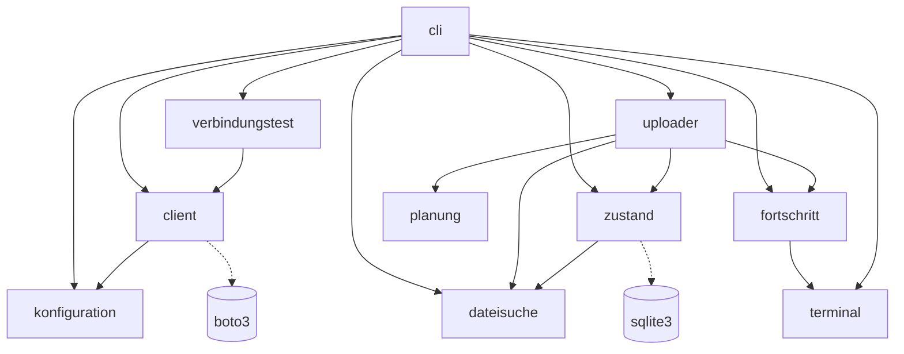
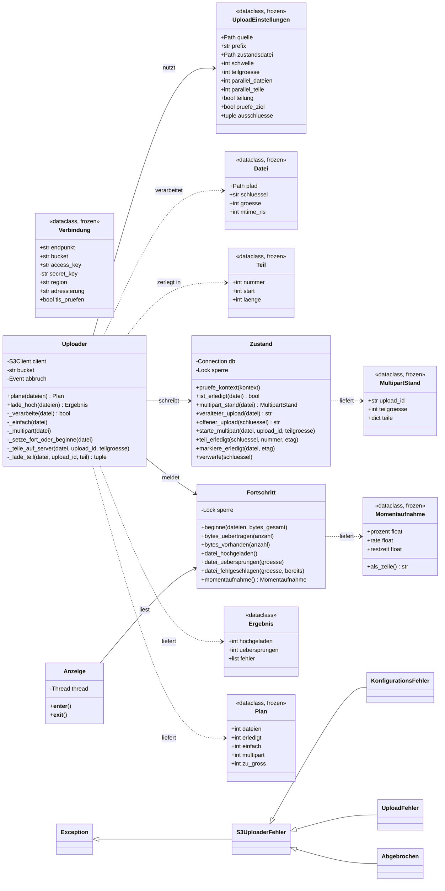
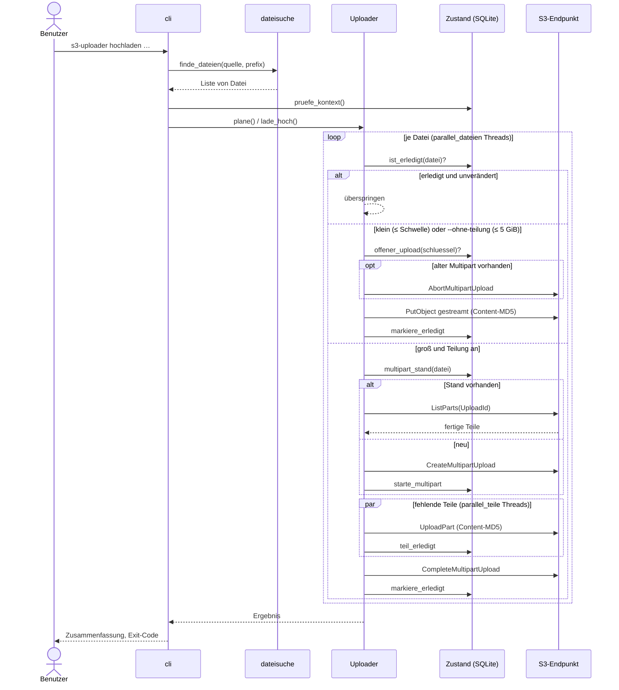
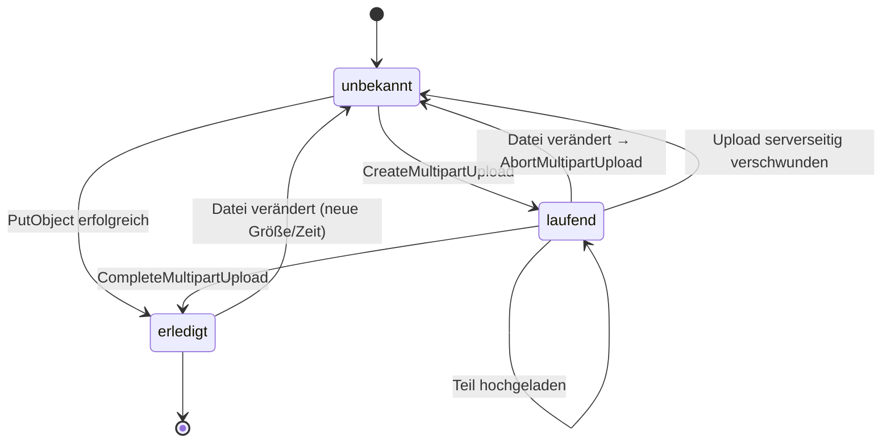
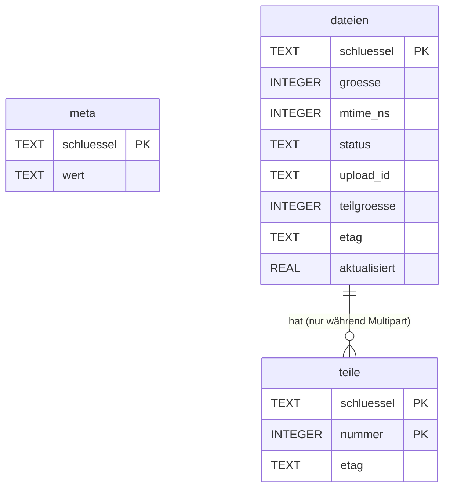

# Architektur von s3-uploader

Die Diagramme sind in Mermaid geschrieben und werden von Gitea direkt dargestellt.

## Module im Überblick

| Modul | Aufgabe |
|---|---|
| `cli.py` | Argumente und Umgebungsvariablen lesen, Objekte bauen, Ausgabe, Exit-Codes |
| `konfiguration.py` | Datenklassen `Verbindung`, `UploadEinstellungen`; Präfix, Größenangaben, Zustandsdatei-Ort |
| `client.py` | boto3-Client mit Zeitlimits, Wiederholungen, Kompatibilitätseinstellungen |
| `verbindungstest.py` | Prüfschritte des Verbindungstests |
| `dateisuche.py` | Quellverzeichnis durchlaufen, `Datei`-Objekte mit Zielschlüssel |
| `planung.py` | Multipart-Entscheidung, Teilgröße, Zerlegung in `Teil`e |
| `uploader.py` | Kern: einfacher Upload, Multipart, Fortsetzen, Parallelität |
| `zustand.py` | SQLite-Zustandsdatei für das Wiederaufsetzen |
| `fortschritt.py` | Threadsichere Zählung, Fortschrittszeile, logging-Handler |
| `terminal.py` | Betriebssystemunabhängige Terminal-Ausgabe (Windows-Konsole, Kodierung, Zeilenbreite) |
| `fehler.py` | Ausnahmehierarchie |

## Paketabhängigkeiten

## Klassendiagramm

## Ablauf eines Uploads (Sequenzdiagramm)

## Zustände einer Datei

`unbekannt` bedeutet: kein Eintrag in der Zustandsdatei. `laufend` und `erledigt` sind die
Werte der Spalte `status` in der Tabelle `dateien`.

## Datenmodell der Zustandsdatei

## Entwurfsentscheidungen

| Entscheidung | Begründung |
|---|---|
| boto3 statt eigener S3-Signatur | Bewährte Signatur (SigV4), Wiederholungen, Paginierung; S3-kompatible Speicher unterstützt |
| Multipart selbst steuern statt `upload_file` | `upload_file` kann nicht über Programmläufe hinweg fortsetzen; eigener Ablauf merkt sich Upload-ID und Teile |
| SQLite als Zustand | In der Standardbibliothek, atomare Schreibvorgänge, schnell auch bei Millionen Einträgen |
| Server (`ListParts`) entscheidet beim Fortsetzen | Ein Teil kann übertragen, aber vor dem Speichern im Zustand abgebrochen worden sein |
| Erkennung von Änderungen über Größe + `mtime_ns` | Prüfsummen über Terabytes vorab zu berechnen wäre zu langsam |
| `Content-MD5` statt boto3-Standardprüfsummen | Wird von praktisch allen S3-kompatiblen Speichern verstanden |
| Teilung abschaltbar (`--ohne-teilung`) | Manche S3-kompatible Speicher unterstützen Multipart nur eingeschränkt; einzelne Uploads liefern einen MD5-ETag |
| Einzelne Uploads gestreamt | Ohne Teilung sind Dateien bis 5 GiB möglich; sie sollen nicht vollständig im Speicher liegen |
| Warten mit Zeitgrenze statt `as_completed` | Unter Windows unterbricht Strg+C ein Warten ohne Zeitgrenze nicht; mit 0,5 s Zeitgrenze reagiert der Abbruch sofort |
| Quellpfad mit `os.path.normcase` vereinheitlicht | Unter Windows sind `D:\Daten` und `d:/daten` derselbe Ordner und müssen dieselbe Zustandsdatei finden |
| Threads statt asyncio | Ein-/Ausgabe-lastig, boto3 ist synchron; Threads sind hier einfach und ausreichend |
